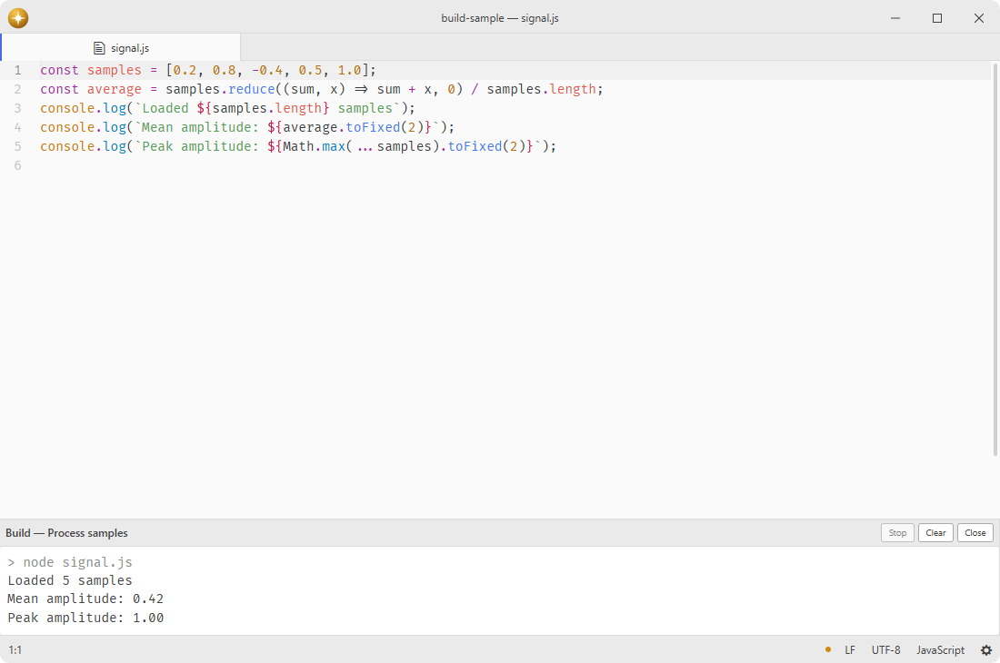

# build

Run project build targets and surface their output and diagnostics.

Fork of [noseglid/atom-build](https://github.com/noseglid/atom-build).

## Features

- **Project targets**: loads safe JSON or YAML target definitions from the project root.
- **Provider targets**: combines configuration with targets contributed through a versioned service.
- **Streaming output**: shows standard output and errors in a bottom-dock tab with build state and output controls.
- **Process control**: saves modified editors, prevents overlapping runs, and escalates stalled termination.
- **Diagnostics**: parses named regular-expression captures, navigates results, and publishes to the linter.
- **Workspace integration**: reports progress through busy-signal and the status bar when available.



## Installation

To install `build` search for it in the Install pane of the Lumine settings, or run the command `lumine --install lumine-code/build`.

## Commands

Commands available in `lumine-workspace`:

- `build:trigger`: run the active target,
- `build:stop`: stop the running target,
- `build:toggle-panel`: show or hide build output,
- `build:clear`: clear retained output,
- `build:select-target`: choose the active target,
- `build:refresh-targets`: reload configuration and providers,
- `build:next-error`: open the next matched diagnostic,
- `build:previous-error`: open the previous matched diagnostic.

## Usage

Left click the status item to choose a target, or middle click to run the active target. Its context menu contains target selection, running and stopping, refreshing targets, output controls and diagnostic navigation.

Build output opens in the bottom dock. Resize the dock to give the log more room, and use its tab to close the view. The toolbar shows the target and run state, with controls to stop the process, clear the log, or copy its output.

Create `.lumine-build.json` in a project root. A document may describe one target or contain a `targets` array:

```json
{
  "targets": [
    {
      "name": "Tests",
      "cmd": "npm",
      "args": ["test"],
      "cwd": ".",
      "env": { "NODE_ENV": "test" },
      "errorMatch": "(?<file>[^:]+):(?<line>\\d+):(?<column>\\d+): (?<message>.+)"
    }
  ]
}
```

`.lumine-build.yaml` and `.lumine-build.yml` accept the same shape. Targets support `name`, `cmd`, string `args`, relative `cwd`, string `env` values, `shell`, `commandName`, and `errorMatch`. The placeholders `{PROJECT_PATH}`, `{FILE_ACTIVE}`, `{FILE_ACTIVE_PATH}`, `{FILE_ACTIVE_NAME}`, `{SELECTION}`, `{ROW}`, and `{COLUMN}` are expanded immediately before a run. Selection text is read only when a target uses `{SELECTION}`; a selection exceeding the runtime string limit rejects that expansion instead of truncating it.

## Customization

Adjust the output surface in your `styles.css`:

```css
.build-panel {
  background: var(--tool-panel-background-color);
  --build-output-line-height: 1.6;
}
```

## Services

- [`build.provider`](docs/build.provider.md): consumed to discover targets supplied by language and tool packages.
- `status-bar`: consumed to show the active target and run state.
- `busy-signal`: consumed to report a target while its process is running.
- `linter.registry`: consumed to publish diagnostics parsed from output.

## Contributing

Got ideas to make this package better, found a bug, or want to help add new features? Just drop your thoughts on GitHub. Any feedback is welcome!
